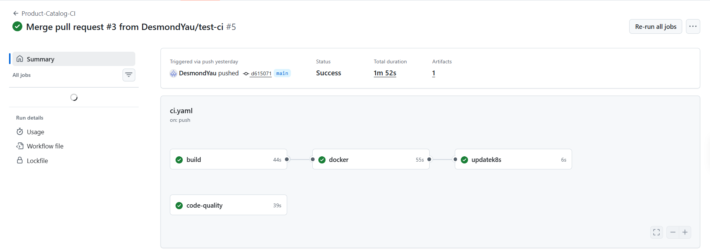
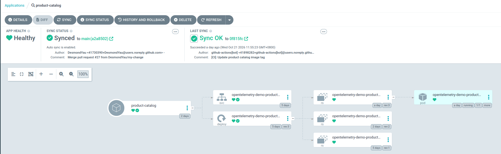
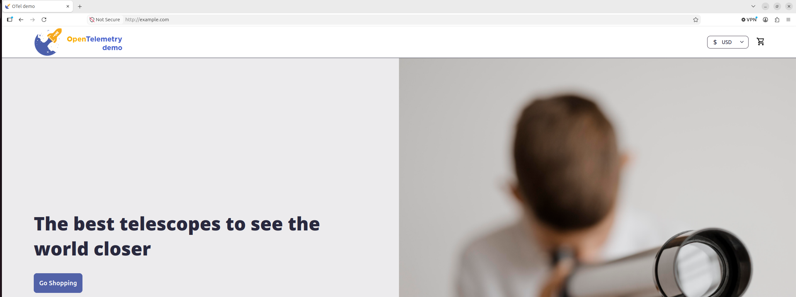

# End-to-End DevOps: Microservices E-commerce on AWS EKS

An end-to-end **CI/CD pipeline** that takes code from pull request to production on
**Amazon EKS**, with infrastructure provisioned in **Terraform**, CI in
**GitHub Actions** and GitOps deployment through **Argo CD**, using the
[OpenTelemetry Demo](https://github.com/open-telemetry/opentelemetry-demo) microservices as the workload.

 

## CI/CD pipeline

The pipeline is set up for the **product-catalog** service as this repo's running
example; the other OpenTelemetry Demo services use their upstream images. See a
[successful run](https://github.com/DesmondYau/End-to-End-DevOps/actions/runs/39540855476)
of all four jobs after a merge to `main`.

How a code change reaches the cluster, with no manual steps after the merge:

1. A developer changes the **product-catalog** service under `src/product-catalog/`
   and opens a pull request to `main`.
2. **GitHub Actions** runs the `build` job (compile and Go unit tests) and the
   `code-quality` job (golangci-lint) on the pull request.
3. Once the checks pass and the pull request is reviewed, it's merged into `main`,
   which triggers the workflow again.
4. The `docker` job builds the image with **Buildx** and pushes it to **Docker Hub**.
5. The `updatek8s` job writes the new image tag into the product catalog's Kubernetes
   Deployment manifest and commits it to `main`.
6. **Argo CD** detects the manifest change and syncs it to the **EKS** cluster.
7. Kubernetes runs a **rolling update**, replacing the old product-catalog pods with
   ones running the new image.

| Stage | Job | Description |
|---|---|---|
| CI: GitHub Actions ([`ci.yaml`](.github/workflows/ci.yaml)) | `build` | Compiles the Go service and runs its tests. |
| CI: GitHub Actions | `code-quality` | Static analysis with golangci-lint. |
| CI: GitHub Actions | `docker` | Builds the image with Buildx and pushes it to Docker Hub, tagged with the workflow run ID. |
| CI: GitHub Actions | `updatek8s` | Writes the new tag into the product catalog's Deployment manifest and pushes the commit to `main` as `github-actions[bot]`. |
| CD: Argo CD ([`cd-product-catelog.yaml`](Argo%20CD/cd-product-catelog.yaml)) | `product-catalog` Application | Watches the repo, notices the manifest commit within about three minutes and rolls out the new image (automated sync with prune and self-heal). |

 

## AWS architecture

| Layer | Resources |
|---|---|
| Network | VPC, 3 public + 3 private subnets across `us-east-1a/b/c`, Internet Gateway, one NAT Gateway per AZ, route tables |
| Compute | EKS 1.36 control plane, managed node group (`t3.medium`, on-demand) |
| IAM | cluster role (`AmazonEKSClusterPolicy`), node role (worker node, CNI and ECR read policies), IRSA role for the ALB controller |
| Traffic | AWS Load Balancer Controller, internet-facing ALB in IP target mode, routing to the frontend proxy |
| State | S3 bucket for Terraform state, DynamoDB table for state locking |

Worker nodes run in private subnets with no public IPs; the only entry point from the
internet is the ALB in the public subnets.

 

## Highlights

1. **Infrastructure as code (Terraform)** ([`terraform/`](terraform/))
   - A production-style **VPC** across **3 availability zones** with **public and
     private subnets**, **NAT gateways** and route tables.
   - An **EKS** cluster with a **managed node group** and separate **IAM roles** for
     the control plane and the nodes.
   - **Remote state** in **S3** with **DynamoDB locking**.
   - Reusable **modules** for network and cluster.

2. **Kubernetes on EKS** ([`kubernetes/`](kubernetes/))
   - Per-service **Deployments and Services** and a dedicated **service account**.
   - An internet-facing **Application Load Balancer** through the **AWS Load Balancer
     Controller**.
   - Worker nodes run in **private subnets** with no public IPs.

3. **Continuous integration (GitHub Actions)** ([`ci.yaml`](.github/workflows/ci.yaml))
   - Every pull request is **built, unit-tested and linted** (golangci-lint).
   - On merge, the pipeline **builds and pushes a Docker image** with **Buildx**.
   - It then **commits the new image tag** to the Kubernetes manifests.

4. **Continuous deployment (Argo CD, GitOps)** ([`Argo CD/`](Argo%20CD/))
   - Argo CD watches the repository and **automatically syncs** the cluster to Git.
   - **Self-healing** and **pruning** keep the cluster matching Git.

 

## Repository layout

| Path | Contents |
|---|---|
| [`terraform/`](terraform/) | root module: providers, S3 backend, VPC and EKS modules, variables |
| [`terraform/backend/`](terraform/backend/) | bootstrap: S3 state bucket and DynamoDB lock table |
| [`terraform/modules/vpc/`](terraform/modules/vpc/) | VPC, subnets, gateways, route tables |
| [`terraform/modules/eks/`](terraform/modules/eks/) | IAM roles, EKS cluster, managed node group |
| [`kubernetes/`](kubernetes/) | one folder per service (Deployment, Service), service account, Ingress in `frontendproxy/` |
| [`IngressController/`](IngressController/) | AWS Load Balancer Controller setup guide and IAM policy |
| [`.github/workflows/ci.yaml`](.github/workflows/ci.yaml) | CI pipeline |
| [`Argo CD/`](Argo%20CD/) | Argo CD installation guide and the product catalog Application |

 

## Screenshots

**1. CI: GitHub Actions after a merge to `main`.** All four jobs pass: `build` and
`code-quality`, then `docker` → `updatek8s`.

**2. CD: Argo CD.** The `product-catalog` application is Healthy and Synced to `main`, with
the last sync triggered by the `github-actions[bot]` image-tag commit.

**3. The deployed shop,** served from EKS through the ALB.

 

## Tech stack

Terraform · AWS (VPC, EKS, EC2, IAM, ALB, S3, DynamoDB) · Kubernetes · Helm ·
AWS Load Balancer Controller · Docker / Buildx · Docker Hub · GitHub Actions ·
Argo CD

 

## Credits

Application code: [OpenTelemetry Demo](https://github.com/open-telemetry/opentelemetry-demo),
licensed under Apache 2.0 (see [LICENSE](LICENSE)). The original README is kept in
[`docs/opentelemetry-demo-README.md`](docs/opentelemetry-demo-README.md).
