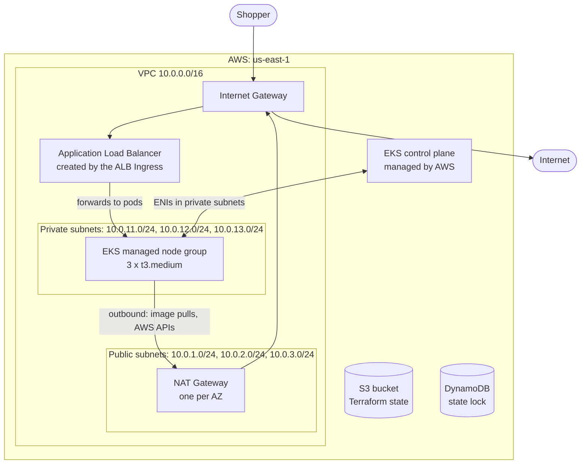
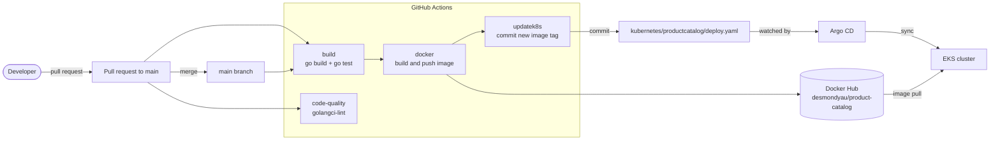

# End-to-End DevOps: Microservices E-commerce on AWS EKS

Building, deploying and running a **19-service microservices application** on
**Amazon EKS**, end to end: **infrastructure as code** with **Terraform**,
**Kubernetes** with an **ALB Ingress**, a **GitHub Actions CI** pipeline and
**GitOps continuous deployment** with **Argo CD**.

From a merged pull request to a running pod with no manual steps:

**Pull request** → **build, test, lint** → **merge** → **Docker image** →
**manifest update** → **Argo CD sync** → **rolling update on EKS**

## Highlights

- **Infrastructure as code (Terraform):** a production-style **VPC** across **3
  availability zones** with **public and private subnets**, **NAT gateways** and
  route tables; an **EKS** cluster with a **managed node group** and separate
  **IAM roles** for the control plane and the nodes; **remote state** in **S3**
  with **DynamoDB locking**; reusable **modules** for network and cluster.
- **Kubernetes on EKS:** per-service **Deployments and Services**, a dedicated
  **service account**, and an internet-facing **Application Load Balancer** through
  the **AWS Load Balancer Controller**, using **IAM roles for service accounts
  (IRSA)**. Worker nodes run in **private subnets** with no public IPs.
- **Continuous integration (GitHub Actions):** every pull request is **built,
  unit-tested and linted** (golangci-lint); on merge, the pipeline **builds and pushes
  a Docker image** with **Buildx** and **commits the new image tag** to the
  Kubernetes manifests.
- **Continuous deployment (Argo CD, GitOps):** Argo CD watches the repository and
  **automatically syncs** the cluster to Git, with **self-healing** and **pruning**,
  rolling out each new image with zero manual `kubectl` steps.

The application itself is the open-source
[OpenTelemetry Demo](https://github.com/open-telemetry/opentelemetry-demo) shop.

## AWS architecture



| Layer | Resources |
|---|---|
| Network | VPC, 3 public + 3 private subnets across `us-east-1a/b/c`, Internet Gateway, one NAT Gateway per AZ, route tables |
| Compute | EKS 1.36 control plane, managed node group (`t3.medium`, on-demand) |
| IAM | cluster role (`AmazonEKSClusterPolicy`), node role (worker node, CNI and ECR read policies), IRSA role for the ALB controller |
| Traffic | AWS Load Balancer Controller, internet-facing ALB in IP target mode, routing to the frontend proxy |
| State | S3 bucket for Terraform state, DynamoDB table for state locking |

Worker nodes run in private subnets with no public IPs; the only entry point from the
internet is the ALB in the public subnets.

## CI/CD pipeline



| Event | Jobs that run |
|---|---|
| Pull request to `main` changing `src/product-catalog/` | `build`, `code-quality` |
| Merge to `main` | `build`, `code-quality`, then `docker` → `updatek8s` |

1. **build**: compiles the Go service and runs its tests.
2. **code-quality**: static analysis with golangci-lint.
3. **docker**: builds the image with Buildx and pushes it to Docker Hub, tagged with
   the workflow run ID.
4. **updatek8s**: writes the new tag into the product catalog's Deployment manifest
   and pushes the commit to `main` as `github-actions[bot]`.
5. **Argo CD** notices the commit within about three minutes and rolls out the new
   image (automated sync with prune and self-heal).

Images and manifest updates only happen after a merge, so unreviewed pull requests
never reach the cluster.

## Repository layout

| Path | Contents |
|---|---|
| [`terraform/`](terraform/) | root module: providers, S3 backend, VPC and EKS modules, variables |
| [`terraform/backend/`](terraform/backend/) | bootstrap: S3 state bucket and DynamoDB lock table |
| [`terraform/modules/vpc/`](terraform/modules/vpc/) | VPC, subnets, gateways, route tables |
| [`terraform/modules/eks/`](terraform/modules/eks/) | IAM roles, EKS cluster, managed node group |
| [`kubernetes/`](kubernetes/) | one folder per service (Deployment, Service), service account, Ingress in `frontendproxy/` |
| [`IngressController/`](IngressController/) | AWS Load Balancer Controller setup guide and IAM policy |
| [`.github/workflows/ci.yaml`](.github/workflows/ci.yaml) | CI pipeline |
| [`Argo CD/`](Argo%20CD/) | Argo CD installation guide and the product catalog Application |
| [`src/`](src/) | application source (OpenTelemetry Demo) |
| [`pb/`](pb/) | gRPC service definitions shared by the services |
| [`docs/`](docs/) | the original OpenTelemetry Demo README |

## The application

An online shop of 19 services written in a dozen languages, talking over gRPC, HTTP
and Kafka:

| Service | Language | Role |
|---|---|---|
| frontend | TypeScript (Next.js) | web UI |
| frontend-proxy | Envoy | entry point behind the ALB |
| product-catalog | Go | product list and search, **built and deployed by this pipeline** |
| cart | C# (.NET) | shopping cart, stored in Valkey |
| checkout | Go | orchestrates an order |
| currency | C++ | currency conversion |
| payment | JavaScript (Node.js) | payment processing |
| shipping | Rust | shipping quotes |
| quote | PHP | shipping cost calculation |
| email | Ruby | order confirmation emails |
| recommendation | Python | product recommendations |
| ad | Java | contextual ads |
| accounting | C# (.NET) | consumes orders from Kafka |
| fraud-detection | Kotlin | consumes orders from Kafka |
| image-provider | nginx | product images |
| load-generator | Python (Locust) | simulated shoppers |
| flagd | — | feature flags |
| kafka, valkey | — | message queue and cache |

The other services run from the upstream OpenTelemetry images; the product catalog
runs from the image built by this repository's pipeline.

## Running it

Prerequisites: AWS CLI, Terraform, kubectl, Helm and eksctl, with AWS credentials
configured.

```bash
# 1. State backend (once)
cd terraform/backend && terraform init && terraform apply

# 2. VPC and EKS
cd .. && terraform init && terraform apply
aws eks update-kubeconfig --name proj-terraform-eks --region us-east-1

# 3. AWS Load Balancer Controller: see IngressController/kubernetes-ingress-controller.md

# 4. The application
cd ../kubernetes
kubectl apply -f serviceaccount.yaml
for dir in */; do kubectl apply -f "$dir"; done
kubectl get ingress -A    # the ALB address

# 5. Argo CD: see "Argo CD/argocd-installation.md"
```

**Tearing down:** delete the Ingress first (`kubectl delete ingress --all -A`) and
wait for the ALB to disappear, then remove the controller's IAM resources and run
`terraform destroy`. The ALB is created by the controller, not Terraform, and would
otherwise block the deletion of the subnets.

## Challenges and decisions

- **Private nodes behind NAT.** Worker nodes have no public IPs. They reach the
  internet (image registries, AWS APIs) through a NAT Gateway in each availability
  zone, and the only inbound path is the ALB.
- **Remote Terraform state.** State lives in S3 with DynamoDB locking, bootstrapped
  by a separate Terraform configuration, so the main configuration can be destroyed
  and rebuilt without losing track of its state.
- **Pod density limits.** With Argo CD installed, two `t3.medium` nodes hit the
  17-pods-per-node limit of the VPC CNI and a rolling update stuck in `Pending`
  ("Too many pods"). Fixed by scaling the node group to three nodes.
- **Linting that actually lints.** An outdated golangci-lint silently skipped its
  checks on Go 1.22 code. After upgrading, it reported three real issues in the
  service (an unused function, a deprecated gRPC call, an unnecessary `Sprintf`),
  which were fixed before merging.
- **Safe GitOps commits.** The image and manifest jobs run only after a merge, and
  the pipeline pushes without `--force`, rebasing first, so it never overwrites
  other commits on `main`.

<!--
Screenshots to add (put images in docs/images/ and link them here):
- a green GitHub Actions run with all four jobs
- the Argo CD UI showing product-catalog Synced / Healthy
- the shop's home page served through the ALB
-->

## Tech stack

Terraform · AWS (VPC, EKS, EC2, IAM, ALB, S3, DynamoDB) · Kubernetes · Helm ·
AWS Load Balancer Controller · Docker / Buildx · Docker Hub · GitHub Actions ·
Argo CD · Go

## Credits

Application code: [OpenTelemetry Demo](https://github.com/open-telemetry/opentelemetry-demo),
licensed under Apache 2.0 (see [LICENSE](LICENSE)). The original README is kept in
[`docs/opentelemetry-demo-README.md`](docs/opentelemetry-demo-README.md).
